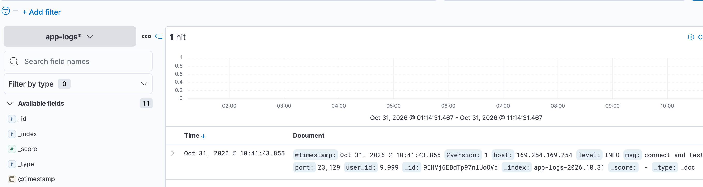

Track the elk leanring process.
i would like to set up the elk on mac
1. check docker enviroment to ensure the memeory is larger than 8G
2. write the docker-compose file and ensure `docker-compose config & docker-compose start -d` can work well. `docker-compose ps` show list the running "es-data, es-ingest, es-query, kibana, garafana,logstash".
3. test the services

## simple test
 -  `curl http://127.0.0.1:9202` and `curl http://127.0.0.1:9202/_cluster/health` to curl `es-query` to test whether the es cluster is running well.
    the response should be:
    ```json
    {
        "name" : "es-query",
        "cluster_name" : "elk-cluster",
        ...
    }
    {"cluster_name":"elk-cluster","status":"green",...}
    ```
- write one log manually to ingest to test es and get its from query directly.
    ```
    curl -X POST http://127.0.0.1:9203/test_index/_doc/1 -H "Content-Type:application/json" -d '{"msg":"write test log to es-ingest"}'
    ```
    ```
    curl http://127.0.0.1:9202/test_index/_doc/1
    ```
## full-chain test
- send one json log to logstash
    ```sh
    python3 << 'EOF'
    import socket
    try:
    s = socket.socket(socket.AF_INET, socket.SOCK_STREAM)
    s.connect(("127.0.0.1", 5043))
    payload=b'{"user_id":9999, "level":"INFO","msg":"connect and test"}\n'
    s.sendall(payload)
    print("--send ok--")
    s.close()
    except Exception as e:
    print(f"error: {e}")
    EOF
    ```
- test es-query receives the log. Note the date timestamp would be changed as yours.
    ```sh
    curl http://127.0.0.1:9202/app-logs-2026.10.31/_search                         
    ```
    we need to get the below output:

    ```json
    {"took":51,"timed_out":false,"_shards":{"total":1,"successful":1,"skipped":0,"failed":0},"hits":{"total":{"value":1,"relation":"eq"},"max_score":1.0,"hits":[{"_index":"app-logs-2026.10.31","_type":"_doc","_id":"9IHVj6EBdTp97nlUoOVd","_score":1.0,"_source":{"@timestamp":"2026-10-31T02:41:43.855Z","port":23129,"host":"169.254.169.254","@version":"1","msg":"connect and test","user_id":9999,"level":"INFO"}}]}}%  
    ```
- test kibana can show log well
the steps are:
1. visit `http://localhost:5602`
2. navigate to **Stack Management → Index Patterns **
3. create index patten and input: `app-logs-*`
4. select the `@timestamp`
5. save
6. navigate to **Discover**，adjust the time range to 12 hours agao
7. then logs would be shown


- test the grafana
the steps are:
1. visit `http://localhost:3000/`
2. input username/password with admin/admin. 
If you have log in the grafana before, the password might be changed, you could enjoy the following cmd to reset password then revisit that url without browser cache.
`docker exec -it grafana grafana cli admin reset-admin-password 123456`
3. add Elasticsearch data source
- Connections → Add data source
- search `Elasticsearch`
- input key data：
    - URL: http://es-query:9200
    - Index name：`app-logs-*`
    - Time field name：`@timestamp`
    - Version： 7.0+（matched to 7.17 image）

4. Save & test
5. create dashboards

- test es-data

    try `curl http://127.0.0.1:9202/_cat/shared/app-logs-2026.10.31`, you will get:

    ```
    app-logs-2026.10.31 0 p STARTED    2 12.9kb 172.19.0.3 es-data
    app-logs-2026.10.31 0 r UNASSIGNED 
    ```
## Knowledge summary
Key data workflows:
- write
logs -> es_ingest/logstash -> es_query -> es-data
- query
kibana/grafana -> es_query -> es_data
